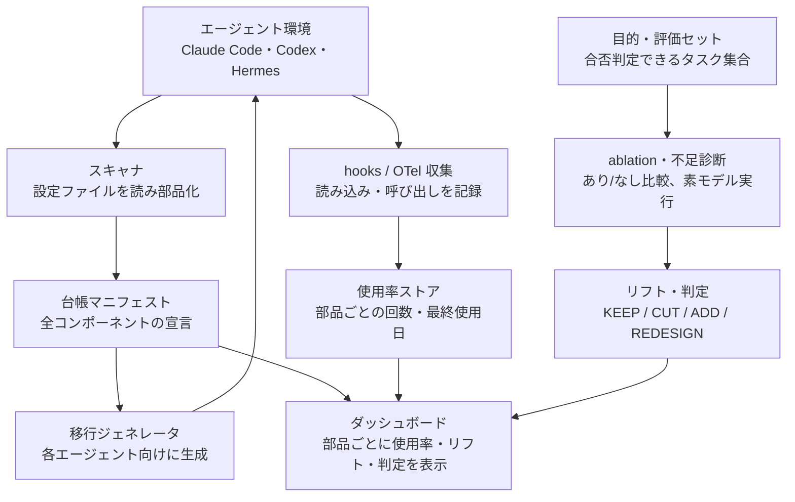

# ハーネス管理ツール 検討仕様書

2026-11-04 時点 · 原本: [Claude Docs](https://claude.ai/artifact/Q9Ac8nLadEuUkeCooHWPoJ)

## 背景と動機

モデルの進化が速く、ハーネスの適正な形が数か月単位で変わる。今は勘で足し引きしているため、効いていない部品が残り、足りない部品に気づくのも遅れる。

- **不要化**：モデルが自力でできるようになり、スキルやルールがコンテキストを食うだけの死重になる
- **不足**：新しい用途や規模に対して、検証・ガードレール・コンテキスト供給が足りなくなる
- **作り直し**：スケールに伴い、部分修正より構成ごと入れ替えたほうが良い時期が来る

2026年に「Agent = Model + Harness」という捉え方が定着し、ハーネスが性能を左右することは広く認められた。一方で、個人やチームの環境でハーネスを継続的に測定・整理する道具はまだ部品単位でしか存在しない。

## 目的と非目的

目的は、ハーネスの各部品について「残す・削る・足す・作り直す」を根拠つきで判断できるようにすること。

**目的**

- 目的（ゴール）を与えると、素のモデルの実力を測り、必要なハーネスと不足を示す
- 稼働中のハーネスの各部品が、どれだけ使われ、どれだけ効いているかを測ってダッシュボードに出す
- 環境内のハーネス配置を一つの台帳で把握し、別エージェントや新構成への移行を簡単にする

**非目的（当面）**

- ハーネスの自動書き換え（判定と提案まで。適用は人が承認）
- 汎用ベンチマークの提供（評価は自分の目的に紐づくタスクのみ）
- チーム横断の共有基盤（まず個人環境で成立させる）

## 用語定義

| 用語 | 意味 |
| --- | --- |
| ハーネス | モデル以外のすべて。指示、スキル、ツール、hooks、サブエージェント、検証、権限、メモリ |
| コンポーネント | 台帳で管理する最小単位。CLAUDE.md / AGENTS.md の1ルール、1スキル、1 hook、1 MCPサーバー、1サブエージェントなど |
| 目的 | 達成したいこと。実行して合否が判定できるタスク集合（評価セット）として表現する |
| 使用率 | コンポーネントが実際に読み込まれた・呼ばれた頻度。トレースから常時取得する |
| 効果（リフト） | そのコンポーネントがある場合とない場合の成果の差。ablationで測る |
| 素モデル | ハーネスを最小限にした状態のモデル。不足診断の基準線 |

## 機能概要

4つの機能を持つ。台帳がすべての土台で、使用率は常時、効果と診断はイベント時に測る。

1. **台帳（棚卸し）**：環境内のハーネスをスキャンし、コンポーネント単位で一覧化する。どのエージェントのどこに、何が置かれているかを可視化する
2. **使用率テレメトリ**：hooksやOpenTelemetryのトレースから、各コンポーネントの読み込み・呼び出し回数を常時記録する。安価で連続的
3. **効果測定（ablation）**：評価セットに対し、コンポーネントのあり/なしを比較してリフトを出す。コストが高いため、モデルのリリース時や構成変更時に走らせる
4. **不足診断**：素モデルで評価セットを走らせ、失敗をパターン分類して、足りないハーネスの種類を提案する

ダッシュボードは1〜4を一画面にまとめ、コンポーネントごとに使用率・リフト・判定を並べる。移行機能は1の台帳から別ターゲット向けの構成を生成する形で提供する。

## 判定モデル

判定は4種類と、判定保留の1つ。数値を無理に作らず、測れないものは「判定保留」と明示する。

| 判定 | 条件 | 推奨アクション |
| --- | --- | --- |
| KEEP | リフトが有意に正 | 残す。次のモデルリリースで再測定 |
| CUT | 素モデルでも同等にできる（不要化）、またはリフトなし | 削除候補として提示 |
| ADD | 素モデルの失敗パターンに対応する部品がない | 追加すべき部品の種類を提案 |
| REDESIGN | CUT判定の割合が閾値を超える、または部品同士の重複・衝突が多い | 構成全体の作り直しを提案 |
| 判定保留 | 評価セットがない、試行回数が足りない | 必要な評価タスクや試行回数を示す |

使用率は判定の補助に使う。「よく使われるがリフトなし」は削除の有力候補、「ほぼ使われないがリフト大」は発見性（トリガー条件）の改善候補になる。

## アーキテクチャ案

台帳マニフェストを中心に、棚卸し・使用率・効果の3系統がダッシュボードに集まる。移行は台帳から各エージェント向けの構成を生成して環境に戻す。

左列が棚卸しと移行、中央が常時の使用率、右列がイベント時の効果測定と不足診断。

## MVP範囲とロードマップ

MVPは「台帳＋使用率ダッシュボード」。数日で作れ、単体で役に立ち、後段の測定の土台になる。

1. **台帳スキャナ**：Claude Codeの `~/.claude` とプロジェクト配下（CLAUDE.md、skills、hooks、agents、MCP設定）を読み、コンポーネント一覧を宣言的マニフェストに出力する
2. **使用率ダッシュボード**：hooksでスキル起動・ツール呼び出し・サブエージェント起動を記録し、コンポーネントごとの使用回数と最終使用日を表示する
3. **ablationランナー**：評価セットに対してあり/なしを複数回実行し、リフトと判定を出す。モデルリリース時に手動または定期で起動
4. **不足診断**：素モデルの失敗パターンを分類し、ADD候補を提示する
5. **移行**：台帳から Codex（AGENTS.md）や Hermes Agent 向けの構成を生成する

対象エージェントは、まずClaude Codeのみ。2以降で他エージェントのアダプタを足す。

## 決定事項と未決事項

**決定事項**

- 使用率（常時・安価）と効果（イベント時・高コスト）は分けて測る
- 判定はKEEP / CUT / ADD / REDESIGNの4種類＋判定保留
- ハーネスは宣言的マニフェスト（台帳）で管理し、各エージェント向け構成はそこから生成する
- MVPは台帳スキャナと使用率ダッシュボードから始める

**未決事項**

- [ ] 「目的」をどう評価セット（実行可能なタスク＋合否判定）に落とすか
- [ ] kaizen-agents-orgのverifierを評価オラクルとして流用できるか
- [ ] ablationの試行回数とコストの上限（何回走らせれば判定してよいか）
- [ ] REDESIGNを出すCUT割合の閾値
- [ ] 部品同士の相互作用（2つ揃って初めて効く）をどう扱うか
- [ ] マニフェストの形式（YAML / Nix / 独自）と、Home Managerとの関係
- [ ] ダッシュボードの置き場所（ローカルWeb、Mac miniサーバー、artifact）

## 参考ソース

| ソース | 何が参考になるか |
| --- | --- |
| [skill-harness](https://pypi.org/project/skill-harness/) | スキルのあり/なし比較でKEEP / CUT / 判定保留を返す。モデルリリースごとに再評価して引退させる運用 |
| [skill-eval-harness](https://cdn.jsdelivr.net/gh/adewale/skill-eval-harness@main/README.md) | スキル内のどの部分が効いているかを部分ablationで調べる。回帰検出 |
| [Tessl harness-eval](https://tessl.io/registry/skills/github/tech-leads-club/agent-skills/harness-eval) | AGENTS.md・rules・skillsの静的監査（壊れたパス、冗長性、有用性） |
| [Agentic Harness Engineering (AHE)](https://www.emergentmind.com/papers/2604.25850) | ハーネス進化のボトルネックは可観測性という主張。部品・経験・判断の3つの観測軸 |
| [Harness-Bench](https://arxiv.org/pdf/2605.27922) | モデル×ハーネスの構成を同条件で比較する評価プロトコル |
| [Expo: Your skills need an evaluation mechanism](https://expo.dev/blog/your-skills-need-an-evaluation-mechanism.md) | 過程（スキル使用）と成果物の両方を評価し、PRのラベルでCI実行する実例 |
| [Arize: Agent harnesses](https://arize.com/?p=30242) | トレースで何を記録すべきか。OpenInference / OpenTelemetryの規約 |
